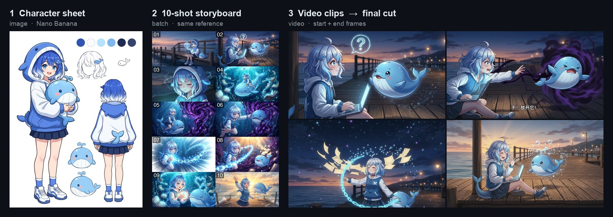
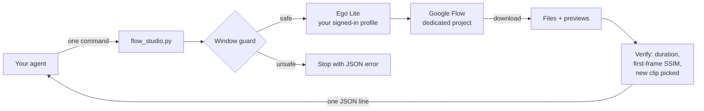
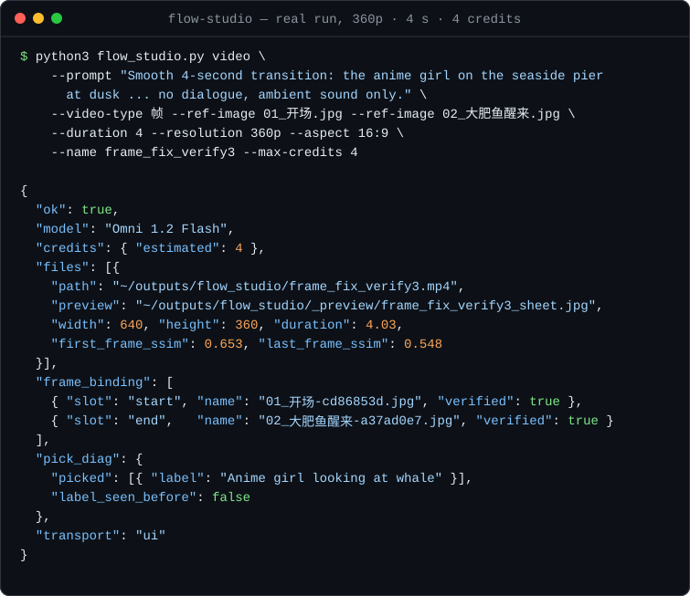
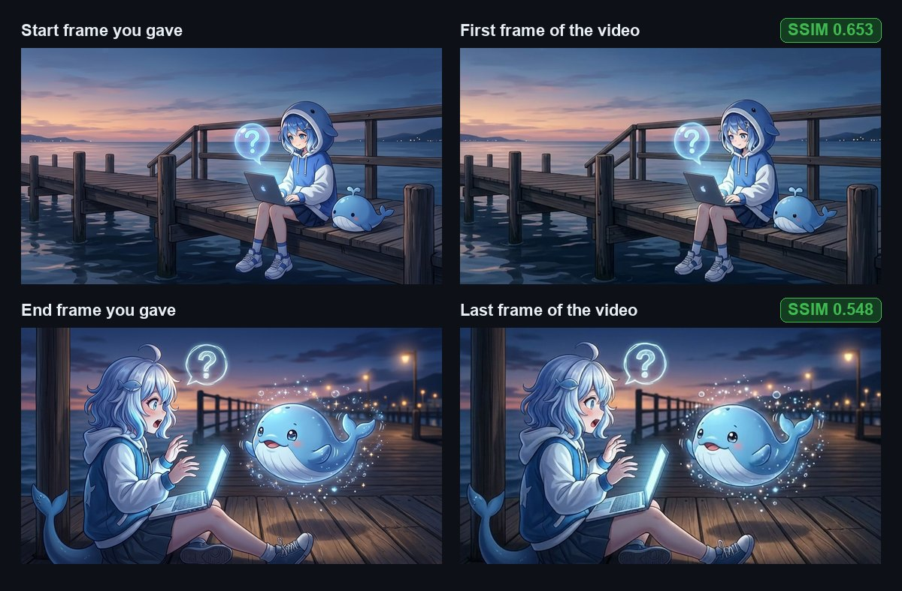

<p align="center">
  
</p>

<h1 align="center">flow-studio</h1>

<p align="center">
  <b>Let your coding agent make images and videos in Google Flow — one command, a hard credit budget, and results it can verify.</b>
</p>

<p align="center">
  <a href="https://github.com/we1jia/flow-studio/actions/workflows/ci.yml"></a>
  <a href="LICENSE"></a>
  
  
  <a href="https://skills.sh"></a>
</p>

<p align="center">
  English · <a href="README.zh-CN.md">简体中文</a>
</p>

<p align="center">
  
  <br>
  <sub>A clip from a 54-second short. The character sheet, the 10-shot storyboard and every video clip were generated with flow-studio; the cut was edited in Palmier Pro.</sub>
</p>

---

flow-studio is an [Agent Skill](https://skills.sh) plus a single-file CLI. It drives [Google Flow](https://labs.google/fx/tools/flow) (Nano Banana, Omni, Veo) through **your own signed-in [Ego Lite](https://lite.ego.app/) browser**, so agents such as Claude Code, Codex and Antigravity can generate images and videos without you exporting cookies or API keys. Every run returns one line of JSON, so the agent knows exactly what happened.

> [!NOTE]
> Independent project, not affiliated with Google. Video generation spends your Flow credits, and spent credits cannot be refunded.

## Contents

- [Why flow-studio](#why-flow-studio)
- [Showcase](#showcase)
- [Requirements](#requirements)
- [Installation](#installation)
- [Quick start](#quick-start)
- [How it works](#how-it-works)
- [Credit safety](#credit-safety)
- [Result verification](#result-verification)
- [Configuration](#configuration)
- [Limitations](#limitations)
- [Troubleshooting](#troubleshooting)
- [Development](#development)
- [Acknowledgements](#acknowledgements) · [License](#license)

## Why flow-studio

| | |
|---|---|
| **One command, one JSON line** | `image`, `video`, `batch` and `credits` subcommands. The output carries file paths, previews, credit estimates and verification results. |
| **Hard credit budget** | Before a video is submitted, flow-studio reads the live cost shown on the page. If it exceeds `--max-credits` / `--max-total-credits`, the run stops **before** anything is charged. |
| **Start and end frames** | Frame mode binds a start frame and an optional end frame to Flow's slots, and the dry run confirms the binding without spending credits. |
| **Verified results** | After a run it checks the clip duration, compares the first frame with your start frame (SSIM), and makes sure it picked the *new* clip, not an older one in the project. |
| **Safe browser sharing** | A window guard runs before and after every job. flow-studio never takes over your windows or another agent's Task Space. |
| **Token-frugal** | Images get a 512 px thumbnail and videos a 4-frame contact sheet, so the agent checks a small preview instead of the full file. |

## Showcase

Made with flow-studio, from character sheet to final cut:

<p align="center">
  
</p>

<p align="center">
  
</p>

## Requirements

| | |
|---|---|
| OS | macOS (the window guard uses `osascript`, thumbnails use `sips`) |
| Browser | [Ego Lite](https://lite.ego.app/) with its `ego-browser` CLI, signed in to a Google account that can use Google Flow |
| Flow UI language | **Simplified Chinese.** Page automation locates controls by their Chinese labels (see [Limitations](#limitations)) |
| Python | Python 3, standard library only (developed and tested on 3.13) |
| Optional | `ffmpeg` / `ffprobe` for video previews, duration checks and SSIM; Node.js to run the tests |

## Installation

### Any agent (recommended)

Use the open [skills](https://github.com/vercel-labs/skills) CLI. It supports Claude Code, Codex, Cursor, OpenCode and many more:

```bash
npx skills add we1jia/flow-studio -g
```

Add `-a claude-code` (or `-a codex`, …) to pick the agent; drop `-g` to install into the current project only.

### Claude Code

Install it as a plugin (Claude Code 2.1.275 or later):

```text
/plugin install flow-studio --marketplace we1jia/flow-studio
```

On older versions, register the marketplace first:

```text
/plugin marketplace add we1jia/flow-studio
/plugin install flow-studio@flow-studio
```

### Antigravity

```bash
agy plugin install https://github.com/we1jia/flow-studio
```

### Manual

```bash
git clone https://github.com/we1jia/flow-studio.git ~/flow-studio
mkdir -p ~/.agents/skills ~/.claude/skills
ln -s ~/flow-studio/skills/flow-studio ~/.agents/skills/flow-studio   # Codex and other agents
ln -s ~/.agents/skills/flow-studio ~/.claude/skills/flow-studio      # Claude Code
```

### Or just ask your agent

> Install the flow-studio skill from https://github.com/we1jia/flow-studio

## Quick start

Talk to your agent in plain language. It follows [`SKILL.md`](skills/flow-studio/SKILL.md): a dry run first, then it asks you to approve a credit amount before anything is charged.

> *Generate four 16:9 images of a red fox in the snow, cinematic lighting.*
>
> *Turn these two storyboard frames into a 4-second 360p clip. Budget: 4 credits.*
>
> *How many Flow credits do I have left?*

Or call the CLI yourself:

```bash
S=~/.agents/skills/flow-studio/flow_studio.py

# Images: Nano Banana 2.1 spends no credits
python3 $S image --prompt "a red fox in snow, cinematic" --aspect 16:9 --count 2

# Video: dry-run for the quote, then run with the budget you accept
python3 $S video --prompt "..." --duration 4 --resolution 360p --dry-run
python3 $S video --prompt "..." --duration 4 --resolution 360p --max-credits 4

# Start + end frames
python3 $S video --prompt "..." --video-type frames \
  --ref-image /abs/start.png --ref-image /abs/end.png --duration 4 --max-credits 4

# A whole shot list (runs one shot at a time; resumable)
python3 $S batch --plan /abs/shots.json --dry-run
python3 $S batch --plan /abs/shots.json --max-total-credits 40 --skip-existing

python3 $S credits
```

Run `python3 flow_studio.py <command> --help` for every option. A `shots.json` example is in [`SKILL.md`](skills/flow-studio/SKILL.md).

## How it works



- **Images** take the fast path by default: a direct request from inside the Flow page, roughly 20–30 seconds per call and no clicking. If that path can't be used, flow-studio falls back to page automation.
- **Videos** always use page automation, so the live cost check runs before every submit.
- Everything happens in one dedicated Flow project (default: `Agent CLI Studio`), so your Flow home page doesn't fill up with empty projects.

## Credit safety

- **Quote first.** `--dry-run` fills the form, reads the cost and stops. In frame mode it also uploads your frames and checks the binding. It never spends credits.
- **Hard ceiling.** If the cost is above `--max-credits` (default 100) or `--max-total-credits`, the run is blocked before submission (`budget_exceeded`). If the cost can't be read, it is blocked too (`unknown_cost`) unless you pass `--allow-unknown-cost`.
- **No silent retries.** A request that may already have been billed is never resent automatically. The error tells the agent whether credits may have been spent and what to check next.
- **Canary runs.** For larger batches, `SKILL.md` tells the agent to run one shot first, check it, then `--skip-existing` the rest.

## Result verification

A real 4-credit run (paths shortened, fields trimmed):

<p align="center">
  
</p>

The start and end frames you gave, next to the first and last frames of the clip Flow produced:

<p align="center">
  
</p>

| Check | Fails as | Meaning |
|---|---|---|
| Duration differs from `--duration` by more than 1.5 s | `result_mismatch` | Wrong clip, or the duration setting didn't apply |
| First frame vs. your start frame, SSIM below 0.4 | `first_frame_mismatch` | The start frame didn't take |
| Picked card's title existed before the run | warning | Possibly an older clip; check before delivering |
| Project title read from the page differs from the requested name | `project_mismatch` (before submit) | A cached or given URL points at another project |
| Reference image in the prompt box isn't the asset you uploaded | `ref_attach_failed` / `composer_not_clean` (before submit) | The picker added a different asset, or something else is attached |
| Image result vs. reference, SSIM (64×36 gray) below 0.15 | `ref_mismatch` with `--keep-layout`, otherwise a warning | The edit wasn't based on your reference |

Failures stop a batch. What the agent sees is the 4-frame preview below, not the full video:

<p align="center">
  
</p>

## Configuration

| Environment variable | Purpose | Default |
|---|---|---|
| `FLOW_STUDIO_OUT_DIR` | Where downloads go | `./outputs/flow_studio` (current directory) |
| `FLOW_STUDIO_PROJECT` | Name of the dedicated Flow project (checked against the page title on every run) | `Agent CLI Studio` |

State and the upload cache live in `~/.cache/flow_studio/`. Option values have English aliases: `--video-type frames|ingredients`, `--thinking low|medium|high`.

## Limitations

- **macOS only**, because Ego Lite and the window guard are macOS-specific.
- **Simplified Chinese Flow UI.** Page automation (videos, reference images and fallback image runs) finds controls by their Chinese labels. With another UI language it fails fast with `unsupported_ui_language`; switch your Google account's display language to Simplified Chinese. English UI support is welcome as a contribution.
- **UI drift.** Flow changes often. When a control can't be found, the run stops with an error instead of guessing.
- **One run at a time per agent.** Concurrent runs from different sessions keep to their own Task Spaces, but queue your shots with `batch` rather than starting parallel jobs.
- Extending clips, chaining shots, upscaling and reusable characters aren't covered. [gflow-cli](https://github.com/ffroliva/gflow-cli) does those.

## Troubleshooting

| You see | Do this |
|---|---|
| `not_logged_in` | Sign in to Google Flow in Ego Lite, then retry |
| `unsupported_ui_language` | Switch your Google account's display language to Simplified Chinese |
| `budget_exceeded` / `unknown_cost` | Nothing was charged. Raise the budget only if you agree with the quote |
| `flow_unusual_activity` | Flow's rate limiting. Nothing was charged; wait a few hours |
| `result_mismatch` / `first_frame_mismatch` | Credits **were** spent. Don't rerun; check the newest clip in the Flow project |
| `no longer assigned to the agent` | Ego Lite ended that Task Space. Don't retry from the agent; continue only when you choose to |

The full error table that agents follow is in [`SKILL.md`](skills/flow-studio/SKILL.md#结果处理).

## Development

```text
skills/flow-studio/      the skill: SKILL.md, flow_studio.py, ego_lite_window_guard.py
tests/                   unit tests (no network, no browser, no credits)
.claude-plugin/          Claude Code plugin + marketplace manifests
.antigravity-plugin/     Antigravity plugin manifest
docs/assets/             README images
```

```bash
python3 -m unittest discover -s tests
```

Issues and pull requests are welcome. When reporting a bug, include the command and the JSON output (`--verbose`), and remove your email and local paths first.

## Acknowledgements

The request format for direct image generation is ported from [gflow-cli](https://github.com/ffroliva/gflow-cli) (MIT); see [`THIRD_PARTY_NOTICES.md`](THIRD_PARTY_NOTICES.md).

## License

[MIT](LICENSE). "Google Flow", "Nano Banana" and "Veo" are trademarks of their respective owners. flow-studio automates the Flow web app on your behalf; make sure that fits the terms that apply to your account.
