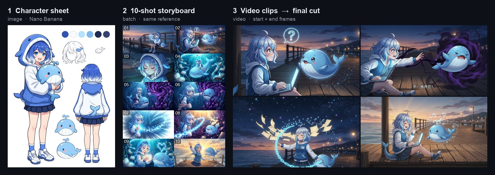
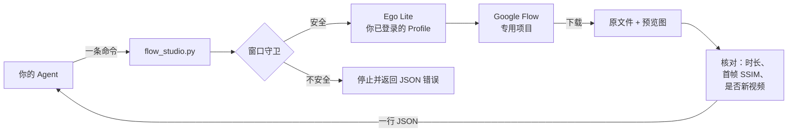
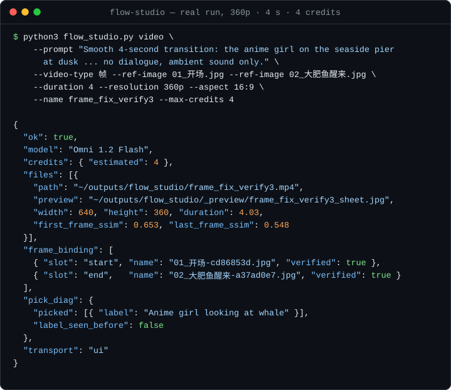
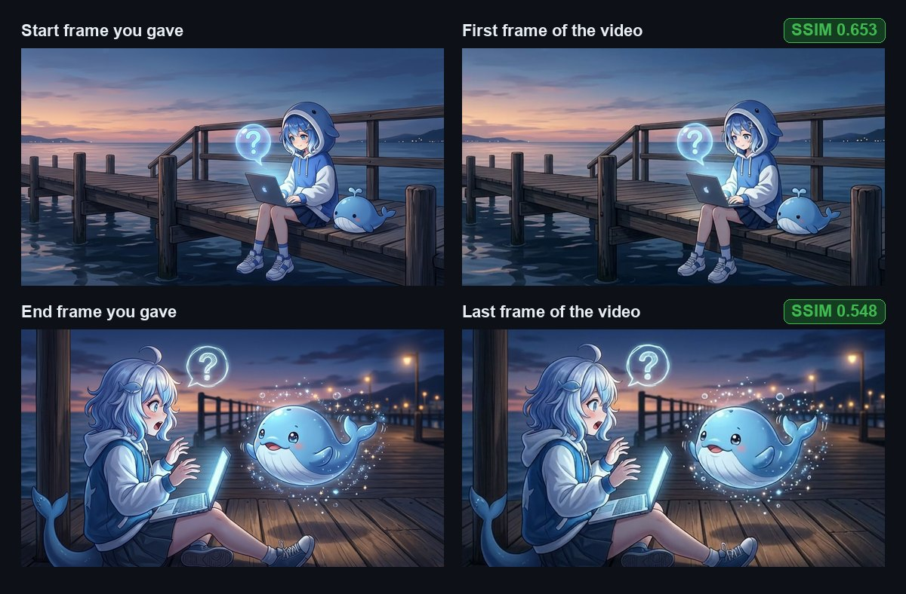

<p align="center">
  
</p>

<h1 align="center">flow-studio</h1>

<p align="center">
  <b>让你的 AI Agent 在 Google Flow 里一条命令生图、生视频：点数有硬上限，成品可核对。</b>
</p>

<p align="center">
  <a href="https://github.com/we1jia/flow-studio/actions/workflows/ci.yml"></a>
  <a href="LICENSE"></a>
  
  
  <a href="https://skills.sh"></a>
</p>

<p align="center">
  <a href="README.md">English</a> · 简体中文
</p>

<p align="center">
  
  <br>
  <sub>一部 54 秒短片的片段。角色设定图、十格分镜和每一段视频都由 flow-studio 生成，最后在 Palmier Pro 里剪辑成片。</sub>
</p>

---

flow-studio 是一个 [Agent Skill](https://skills.sh)，外加一个单文件命令行工具。它通过**你自己已登录的 [Ego Lite](https://lite.ego.app/) 浏览器**驱动 [Google Flow](https://labs.google/fx/tools/flow)（Nano Banana、Omni、Veo）。Claude Code、Codex、Antigravity 等 Agent 不需要你导出 Cookie 或 API Key 就能生图、生视频。每次运行只返回一行 JSON，Agent 能准确知道发生了什么。

> [!NOTE]
> 本项目是独立的非官方工具，与 Google 无关。生成视频会消耗你账号的 Flow 点数，扣掉的点数无法退回。

## 目录

- [为什么用 flow-studio](#为什么用-flow-studio)
- [作品展示](#作品展示)
- [环境要求](#环境要求)
- [安装](#安装)
- [快速上手](#快速上手)
- [工作原理](#工作原理)
- [点数保护](#点数保护)
- [结果核对](#结果核对)
- [配置](#配置)
- [限制](#限制)
- [常见问题](#常见问题)
- [开发](#开发)
- [致谢](#致谢) · [许可](#许可)

## 为什么用 flow-studio

| | |
|---|---|
| **一条命令，一行 JSON** | `image`、`video`、`batch`、`credits` 四个子命令；输出里有文件路径、预览图、扣点预估和核对结果 |
| **点数硬上限** | 提交视频前读取页面上的实时扣点，超过 `--max-credits` / `--max-total-credits` 就在**提交前**拦下，不扣点 |
| **首帧与尾帧** | 帧模式把首帧和可选的尾帧绑定到 Flow 对应的位置；干跑就能确认绑定是否生效，不花点数 |
| **成品可核对** | 跑完核对时长，用 SSIM 比对成片首帧和你给的首帧，并确认取回的是*这次*生成的视频，不是项目里的旧视频 |
| **不抢浏览器** | 每次运行前后都跑窗口守卫，不接管你的窗口，也不碰其他 Agent 的 Task Space |
| **省 Token** | 图片附 512px 缩略图，视频附 4 帧拼图，Agent 看小预览就能检查，不用读原文件 |

## 作品展示

全部用 flow-studio 完成，从角色设定到成片：

<p align="center">
  
</p>

<p align="center">
  
</p>

## 环境要求

| | |
|---|---|
| 系统 | macOS（窗口守卫用 `osascript`，缩略图用 `sips`） |
| 浏览器 | [Ego Lite](https://lite.ego.app/)，带 `ego-browser` 命令；在其中登录可以使用 Google Flow 的 Google 账号 |
| Flow 界面语言 | **简体中文**。页面自动化按中文标签定位控件，见[限制](#限制) |
| Python | Python 3，只用标准库（开发与测试用 3.13） |
| 可选 | `ffmpeg` / `ffprobe`：视频预览、时长核对和 SSIM；Node.js：跑测试 |

## 安装

### 任意 Agent（推荐）

用开源的 [skills](https://github.com/vercel-labs/skills) 命令行安装，支持 Claude Code、Codex、Cursor、OpenCode 等：

```bash
npx skills add we1jia/flow-studio -g
```

加 `-a claude-code`（或 `-a codex` 等）指定 Agent；去掉 `-g` 则只装到当前项目。

### Claude Code

作为插件安装（Claude Code 2.1.275 及以上）：

```text
/plugin install flow-studio --marketplace we1jia/flow-studio
```

旧版本先添加市场再安装：

```text
/plugin marketplace add we1jia/flow-studio
/plugin install flow-studio@flow-studio
```

### Antigravity

```bash
agy plugin install https://github.com/we1jia/flow-studio
```

### 手动安装

```bash
git clone https://github.com/we1jia/flow-studio.git ~/flow-studio
mkdir -p ~/.agents/skills ~/.claude/skills
ln -s ~/flow-studio/skills/flow-studio ~/.agents/skills/flow-studio   # Codex 等 Agent
ln -s ~/.agents/skills/flow-studio ~/.claude/skills/flow-studio      # Claude Code
```

### 或者直接让 Agent 装

> 从 https://github.com/we1jia/flow-studio 安装 flow-studio 这个 skill

## 快速上手

直接用自然语言跟 Agent 说。Agent 会按 [`SKILL.md`](skills/flow-studio/SKILL.md) 先干跑拿报价，你同意具体点数后才真跑：

> *用 Flow 生成 4 张 16:9 的雪地红狐，电影感光线。*
>
> *把这两张分镜做成 4 秒 360p 的视频，预算 4 点。*
>
> *我的 Flow 还剩多少点？*

也可以自己调用命令行：

```bash
S=~/.agents/skills/flow-studio/flow_studio.py

# 生图：Nano Banana 2.1 不扣点
python3 $S image --prompt "a red fox in snow, cinematic" --aspect 16:9 --count 2

# 视频：先干跑看报价，再按你接受的上限真跑
python3 $S video --prompt "..." --duration 4 --resolution 360p --dry-run
python3 $S video --prompt "..." --duration 4 --resolution 360p --max-credits 4

# 首帧 + 尾帧
python3 $S video --prompt "..." --video-type 帧 \
  --ref-image /abs/首帧.png --ref-image /abs/尾帧.png --duration 4 --max-credits 4

# 整组镜头（逐条串行，可续跑）
python3 $S batch --plan /abs/shots.json --dry-run
python3 $S batch --plan /abs/shots.json --max-total-credits 40 --skip-existing

python3 $S credits
```

全部参数看 `python3 flow_studio.py <子命令> --help`；`shots.json` 示例见 [`SKILL.md`](skills/flow-studio/SKILL.md)。

## 工作原理



- **生图**默认走快速路径：在 Flow 页面内直接发请求，每次约 20~30 秒，不用模拟点击；这条路走不通时自动改走页面自动化。
- **生视频**始终走页面自动化，每次提交前都会核对实时扣点。
- 所有生成都放在 Flow 里同一个专用项目（默认 `Agent CLI Studio`），Flow 首页不会被刷出一堆空项目。

## 点数保护

- **先报价**：`--dry-run` 填好表单、读出扣点后就停下；帧模式还会真实上传首尾帧并核对绑定。干跑不扣点。
- **硬上限**：扣点超过 `--max-credits`（默认 100）或 `--max-total-credits`，提交前就会被拦下（`budget_exceeded`）；读不出扣点同样拦下（`unknown_cost`），除非显式加 `--allow-unknown-cost`。
- **不偷偷重试**：可能已经扣点的请求绝不自动重发；错误信息会告诉 Agent 点数可能扣了没有、下一步该查什么。
- **金丝雀**：批量较大时，`SKILL.md` 要求 Agent 先真跑第一条，核对没问题再用 `--skip-existing` 跑其余。

## 结果核对

一次真实的 4 点运行（路径已缩短，字段有精简）：

<p align="center">
  
</p>

你给的首帧、尾帧，与 Flow 生成视频的实际首帧、末帧对比：

<p align="center">
  
</p>

| 核对项 | 不通过时 | 含义 |
|---|---|---|
| 时长与 `--duration` 相差超过 1.5 秒 | `result_mismatch` | 拿错了视频，或时长设置没生效 |
| 成片首帧与你的首帧 SSIM 低于 0.4 | `first_frame_mismatch` | 首帧没生效 |
| 选中卡片的标题在生成前就存在 | 警告 | 可能是旧视频，交付前先核对 |
| 页面上读到的项目名与要求的不一致 | `project_mismatch`（提交前） | 缓存或指定的地址是别的项目 |
| 输入框里的参考图不是你上传的那张 | `ref_attach_failed` / `composer_not_clean`（提交前） | 素材面板加进了别的图，或输入框里有别的附件 |
| 图片成品与参考图 SSIM（64×36 灰度）低于 0.15 | 加 `--keep-layout` 时 `ref_mismatch`，否则警告 | 不是照你的参考图改的 |

不通过都会让批量停下。Agent 检查时看的是下面这张 4 帧预览，不读整段视频：

<p align="center">
  
</p>

## 配置

| 环境变量 | 作用 | 默认 |
|---|---|---|
| `FLOW_STUDIO_OUT_DIR` | 成品下载目录 | 当前目录下的 `outputs/flow_studio` |
| `FLOW_STUDIO_PROJECT` | Flow 里专用项目的名字（每次打开后按页面上的项目名核对） | `Agent CLI Studio` |

运行状态和上传缓存在 `~/.cache/flow_studio/`。参数值有英文别名：`--video-type frames|ingredients`、`--thinking low|medium|high`。

## 限制

- **只支持 macOS**：Ego Lite 和窗口守卫都依赖 macOS。
- **Flow 界面需为简体中文**：页面自动化（视频、参考图、生图回退）按中文标签定位控件。其他语言会直接报 `unsupported_ui_language`，请把 Google 账号显示语言切到简体中文。欢迎贡献英文界面支持。
- **界面会变**：Flow 改版频繁，找不到控件时会报错停下，不会瞎猜。
- **每个 Agent 一次只跑一个任务**：不同会话同时运行时各用各的 Task Space，但多个镜头请用 `batch` 排队，不要并发开多个任务。
- 续写视频、镜头接力、超分、可复用角色不在本工具范围内，可以用 [gflow-cli](https://github.com/ffroliva/gflow-cli)。

## 常见问题

| 看到 | 怎么做 |
|---|---|
| `not_logged_in` | 在 Ego Lite 里登录 Google Flow 后重试 |
| `unsupported_ui_language` | 把 Google 账号显示语言切到简体中文 |
| `budget_exceeded` / `unknown_cost` | 没扣点。同意报价后再调高上限 |
| `flow_unusual_activity` | Flow 风控，没扣点；等几个小时再试 |
| `result_mismatch` / `first_frame_mismatch` | 点数**已扣**。不要重跑，先去 Flow 项目里看最新一条视频 |
| `no longer assigned to the agent` | Ego Lite 已结束这个 Task Space。Agent 不要重试，由你决定是否继续 |

Agent 遵循的完整错误处理表见 [`SKILL.md`](skills/flow-studio/SKILL.md#结果处理)。

## 开发

```text
skills/flow-studio/      skill 本体：SKILL.md、flow_studio.py、ego_lite_window_guard.py
tests/                   单元测试（不联网、不开浏览器、不扣点）
.claude-plugin/          Claude Code 插件与市场清单
.antigravity-plugin/     Antigravity 插件清单
docs/assets/             README 配图
```

```bash
python3 -m unittest discover -s tests
```

欢迎提 Issue 和 PR。报 bug 时请附上命令和 JSON 输出（加 `--verbose`），并先删掉邮箱和本地路径。

## 致谢

生图直连的请求格式移植自 [gflow-cli](https://github.com/ffroliva/gflow-cli)（MIT），见 [`THIRD_PARTY_NOTICES.md`](THIRD_PARTY_NOTICES.md)。

## 许可

[MIT](LICENSE)。“Google Flow”“Nano Banana”“Veo”等名称归各自权利人所有。flow-studio 代你自动操作 Flow 网页，请自行确认这符合你账号适用的服务条款。
